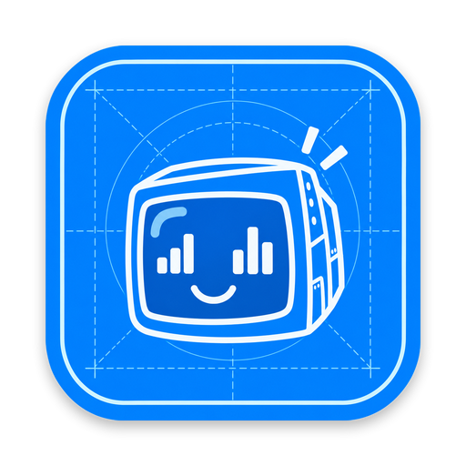
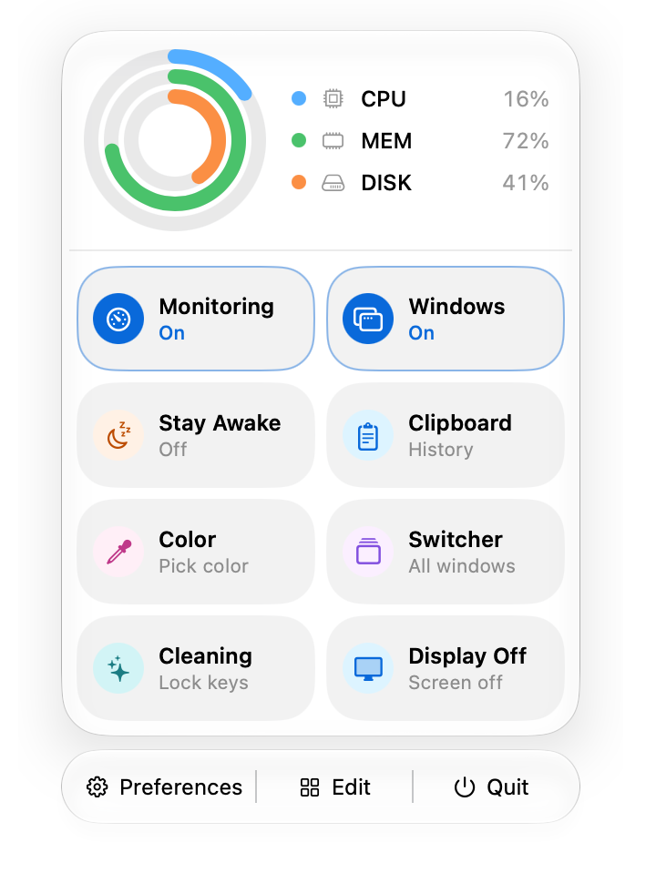
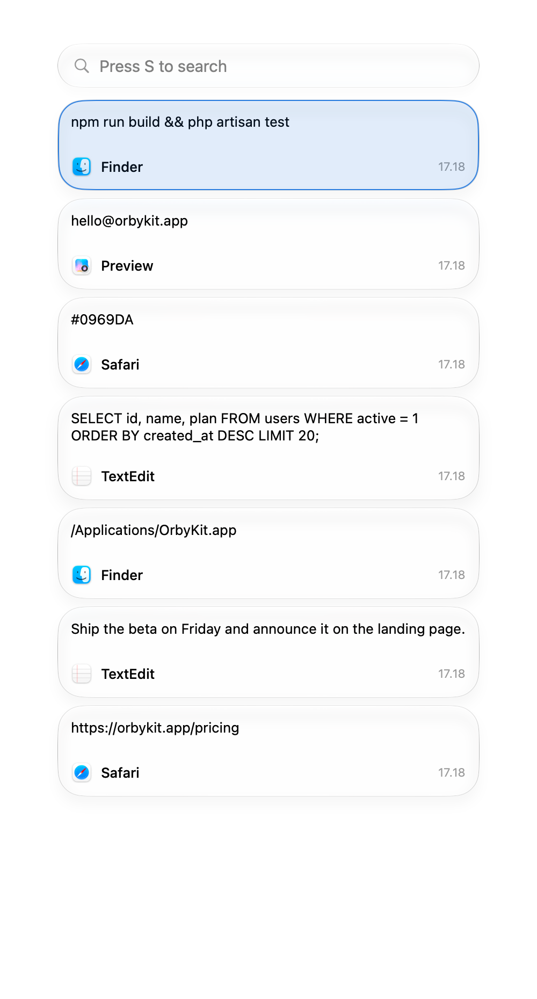
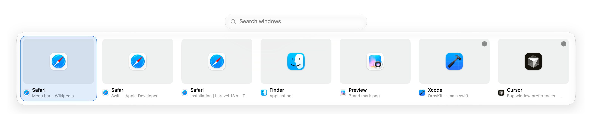
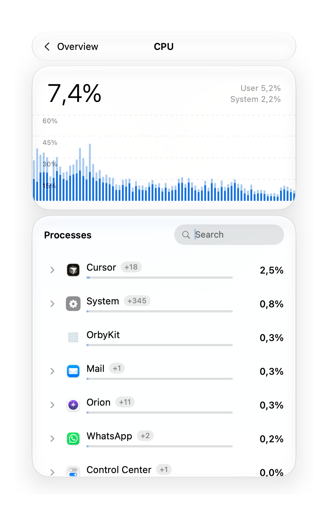
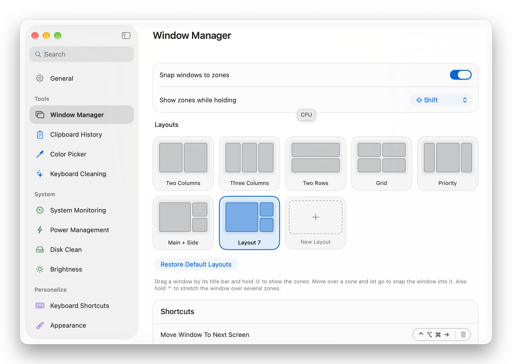

<div align="center">



# OrbyKit

**Nine small tools for your Mac, behind one menu bar icon.**

Clipboard history, window snapping, a window switcher, live system monitoring and more.
Native, quiet, and built for macOS.

[**Download the latest release**](../../releases/latest) &nbsp;·&nbsp; [All versions](../../releases)


</div>

<br>

<table>
<tr>
<td width="50%"></td>
<td width="50%"></td>
</tr>
</table>



---

## What is inside

| Tool | What it does | |
| --- | --- | --- |
| **Clipboard history** | Everything you copy, searchable. Paste it as it was, as plain text, or copy it back. | Free · unlimited in Plus |
| **Window manager** | Snap windows into zones with ready-made layouts, on every monitor. | Free · draw your own zones in Plus |
| **Window switcher** | Alt-Tab for windows: a row of cards, a search field, and the keyboard. | Free |
| **System monitoring** | CPU, memory, network and disk at a glance, with live charts. | Free · per-app detail in Plus |
| **Color picker** | Pick any color on screen and copy it as HEX, RGB, HSL and more. | Free |
| **Keyboard cleaning** | Lock every key for a few minutes so you can wipe the keyboard. | Free |
| **Prevent sleep** | Keep the Mac awake, safely, until you quit OrbyKit or turn it off. | Free |
| **Disk clean** | Find caches and leftovers that are safe to remove, and see the space. | Plus |
| **Monitor brightness** | Change an external monitor's own backlight from the keyboard. | Plus |

<table>
<tr>
<td width="50%"></td>
<td width="50%"></td>
</tr>
</table>

## Free and Plus

OrbyKit is free to use, with no time limit. **Plus** adds Disk Clean, monitor brightness, per-app usage and menu bar widgets,
your own zone layouts, unlimited clipboard history and the Appearance settings. You can try Plus free for 30 days: claim a trial key
on the website and paste it into **Preferences → License**.

If a Plus license ends, nothing is deleted. Your clipboard history, layouts and settings stay; Plus features simply pause until you renew.

## Install

1. Download the latest `OrbyKit-<version>.dmg` from [Releases](../../releases/latest).
2. Open it and drag **OrbyKit** into **Applications**.
3. Open OrbyKit. macOS will say it cannot verify the app, because OrbyKit is not notarized by Apple yet. This happens once.

   **macOS 15 or later:** click **Done**, open **System Settings → Privacy & Security**, scroll to **Security**, click **Open Anyway** next to OrbyKit, and confirm with your password.

   **macOS 14:** right-click OrbyKit, choose **Open**, then **Open** again.
4. When OrbyKit asks, allow **Accessibility** in System Settings. It is how OrbyKit moves windows, lists them in the switcher, and pastes for you.

<details>
<summary>Terminal alternative, and checking your download</summary>

<br>

Instead of the steps above, remove the quarantine mark macOS put on the app:

```sh
xattr -d com.apple.quarantine /Applications/OrbyKit.app
```

To check that the file is the one that was published, compare its checksum with the SHA-256 shown in the release notes:

```sh
shasum -a 256 OrbyKit-<version>.dmg
```

</details>

## Updates

OrbyKit checks for updates by itself and asks before installing anything. You can also use **Preferences → License → Check for Updates**.
Free and Plus both receive updates. A lifetime license covers the releases made while its update period runs.

## Privacy

No analytics and no tracking. The only time OrbyKit talks to a server is to check a license: the license key, an anonymous code for your Mac,
its name and model, and the OrbyKit version. Clipboard history and everything else stays on your Mac.

## Requirements

- macOS 14 or later (the glass look is used on macOS 26)
- A Mac with Apple silicon

## About this repository

This repository only hosts the downloads. OrbyKit is not open source, so there is no code here.
For questions or bug reports, [open an issue](../../issues).

<br>

<div align="center">

<sub>© Aslam Thariq Akbar Akrami · OrbyKit is not affiliated with Apple. Mac is a trademark of Apple Inc.</sub>

</div>
